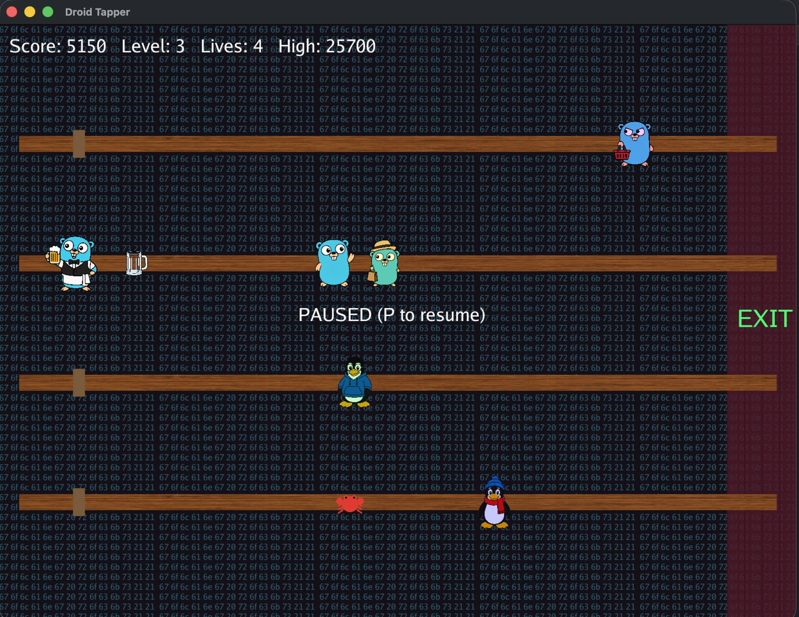

# Droid Tapper

A fast-paced arcade bartending game built with Go and [Ebiten](https://ebitengine.org/). Slide between four bars, pour mugs of beer, serve thirsty customers before they reach the tap, and catch the empties before they smash — all while dodging mischievous power-ups.



## Gameplay

You play the bartender at a multi-bar tavern. Customers approach from the right on one of four bars; you must:

- **Serve** — stand at the tap (left side of a bar) and pour a filled mug that slides toward the customer.
- **Catch** — once a customer is served, an empty mug slides back toward you; catch it before it hits the left wall or you lose a life.
- **Survive** — if a customer reaches the tap, you lose a life. Run out of lives and it's game over.

Clear a level by serving every customer in that level (the target count grows each level, and customers move faster). Your high score is saved between sessions.

### Power-ups

Power-ups drift in from the right on random bars every ~14 seconds. Pick one up by touching it with the bartender:

| Icon | Name | Effect |
|------|------|--------|
| JS (yellow) | Slow you | Bartender moves at half speed for 30s (cancels CRAB) |
| CRAB (red) | Speed you | Bartender moves 1.8× faster for 30s (cancels JS) |
| TS (blue) | Slow customers | Customers move at half speed for 30s |
| NUKE (radiation) | Clear mugs | Clears all mugs on screen and resets customers |

Power-ups can be toggled individually in the settings menu.

## Controls

| Key | Action |
|-----|--------|
| `Enter` / `Space` | Start / restart game |
| `W` / `↑` | Move up one bar |
| `S` / `↓` | Move down one bar |
| `A` / `←` | Move left along the bar |
| `D` / `→` | Move right along the bar |
| `A` / `←` (double-tap) | Snap back to the tap |
| `Space` | Serve a mug |
| `P` | Pause / resume |
| `O` | Open settings |
| `Esc` / `Backspace` | Back (settings) / quit |

All keys are remappable from the **Settings** menu, and bindings are persisted.

## Building & Running

Requires **Go 1.26+** and a working C toolchain for Ebiten (see [Ebiten's install guide](https://ebitengine.org/en/documents/install.html)).

```sh
# Run directly
go run ./cmd/tapper

# Or with Task
task run
```

### Build a binary

```sh
task build        # produces bin/tapper
# or
go build -trimpath -ldflags="-s -w" -o bin/tapper ./cmd/tapper
```

### Tests

```sh
task test         # go test ./...
task test:race    # with race detector
task test:cover   # with coverage
```

### Other tasks

```sh
task fmt   # gofmt
task vet   # go vet
task check # fmt + vet + test
task clean # remove build artifacts
```

## Project Structure

```
droid-tapper/
├── cmd/tapper/              # entry point
├── internal/
│   ├── domain/game/         # pure game logic (no I/O)
│   ├── application/         # service layer: input, audio, ticks, settings
│   ├── ports/               # interfaces (input, audio, storage, settings)
│   └── adapters/
│       ├── ebiten/          # renderer, input, assets
│       ├── audio/           # procedural sound (Ebiten audio)
│       ├── rng/             # RNG adapter
│       └── storage/         # JSON high-score & settings persistence
├── assets/                  # embedded sprites
├── Taskfile.yml
└── go.mod
```

The codebase follows a hexagonal (ports-and-adapters) layout: the domain package is pure and fully unit-testable, while adapters handle I/O, rendering, and persistence.

## Persistence

High score and settings are stored as JSON in your OS config directory:

- `…/droid-tapper/highscore.json`
- `…/droid-tapper/settings.json`

## License

No license file is included yet. All rights reserved by the author unless stated otherwise.